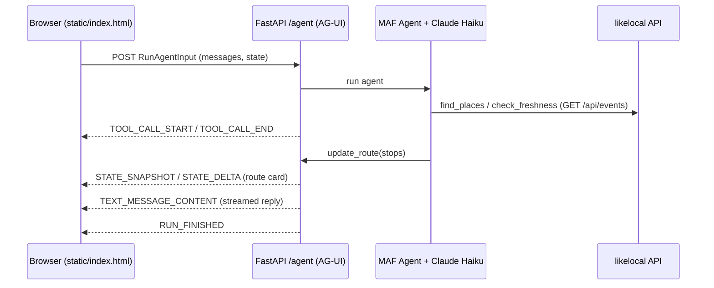

# Route Buddy

A tiny walking-route assistant built on Microsoft Agent Framework (Python) and served over the AG-UI protocol, using public likelocal data. Powered by Claude Haiku.

Portfolio handoff: [docs/portfolio-handoff.md](docs/portfolio-handoff.md)

Ask for a walk ("a fun walk in Austin") and watch the tool calls and the route build up live.

## Event flow



## Run locally

```bash
python3 -m venv .venv && .venv/bin/pip install -r requirements-dev.txt
cp .env.example .env   # fill in ANTHROPIC_API_KEY (and optionally ANTHROPIC_MODEL)
set -a; . ./.env; set +a
.venv/bin/uvicorn app.main:app --port 8000
# open http://localhost:8000
.venv/bin/python -m pytest
```

| Env var | Default |
|---|---|
| `ANTHROPIC_API_KEY` | required |
| `ANTHROPIC_MODEL` | `claude-haiku-5-5` |
| `MAX_TOKENS_PER_RUN` | `1024` |
| `RUNS_PER_IP_PER_HOUR` | `10` |
| `LIKELOCAL_URL` | `https://likelocal-production.up.railway.app` |

## Deploy

One Railway service from the `Dockerfile`; it listens on `$PORT` and `GET /health` returns 200. Set `ANTHROPIC_API_KEY` as a Railway variable.

## Notes

- Tools only issue `GET /api/events?city=<slug>` against likelocal (read-only). "Places" are likelocal events/spots; "freshness" is summarised from each place's `lastCheckedAt`.
- The rate limit is in-memory and per-IP, so it assumes a single instance.
