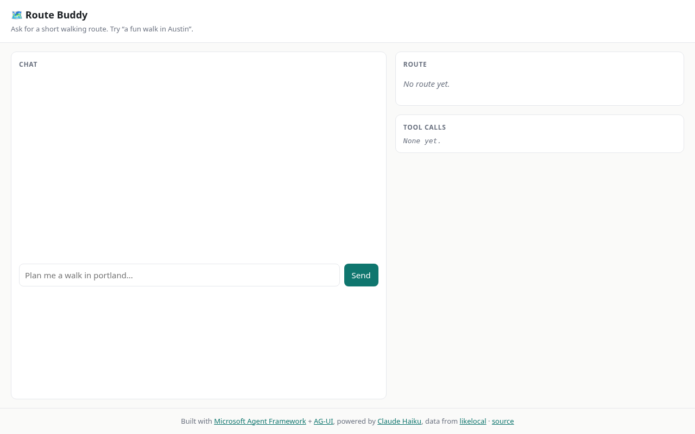

# Portfolio handoff: Route Buddy

**Repo:** https://github.com/AQuantumArchitect/route-buddy (public)
**Live:** https://route-buddy-production.up.railway.app

## Route Buddy

- **Pitch:** A tiny walking-route assistant built on Microsoft Agent Framework and the AG-UI protocol, powered by Claude Haiku. It reads public, read-only likelocal data; ask for a walk ("a fun walk in Austin") and watch the tool calls and the route card build up live.
- **Origin:** DARK (Luke to supply)
- **Event flow:** the sequence diagram in the [README](../README.md#event-flow).
- **Screenshot:** [`docs/screens/route-buddy.png`](screens/route-buddy.png) (the static page, no agent run)

## Honest limits

- Rate limits are in-memory and per-IP, so they assume a single instance.
- Data comes only from likelocal's `/api/events`; there is no other source.
- It needs an Anthropic API key to run.

## Suggested tags

`route-buddy`, `ai-agent`, `microsoft-agent-framework`, `ag-ui`, `claude-haiku`, `fastapi`, `python`, `walking`, `likelocal`, `railway`
